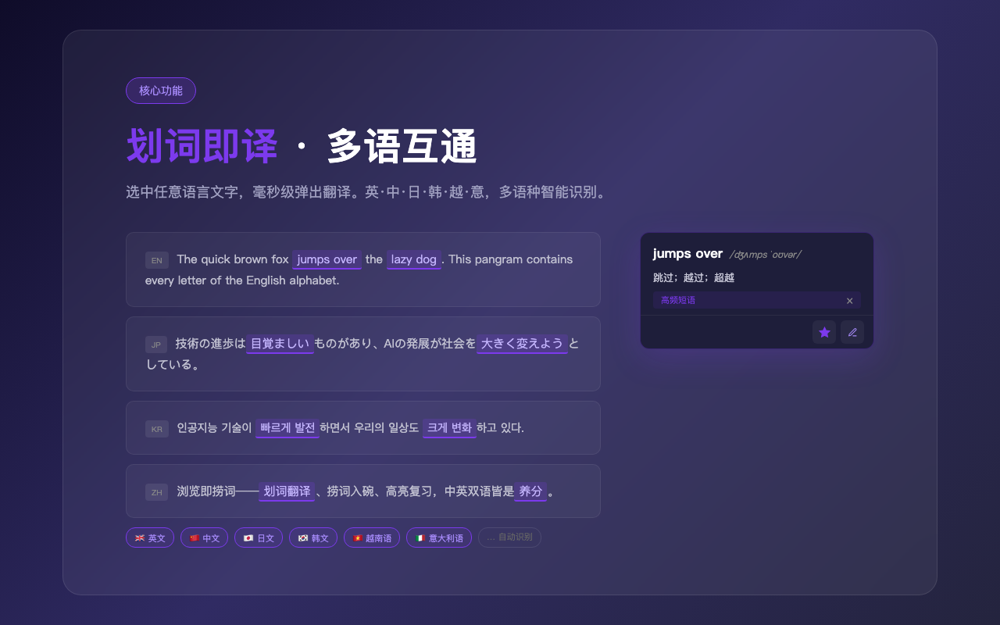
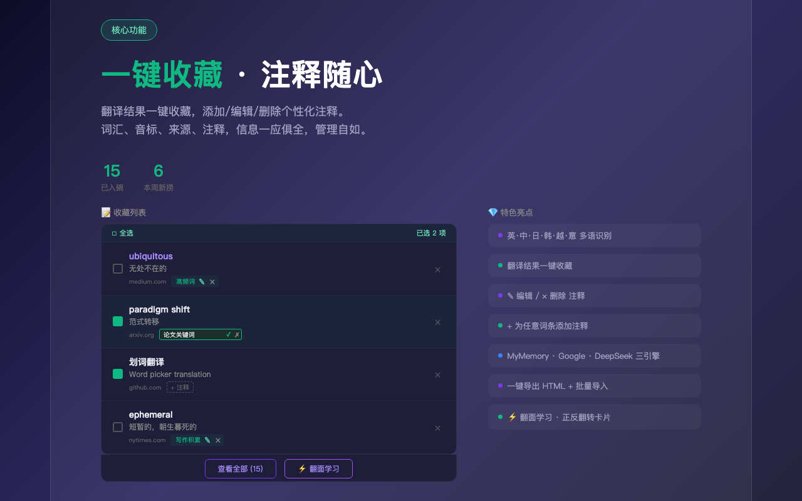
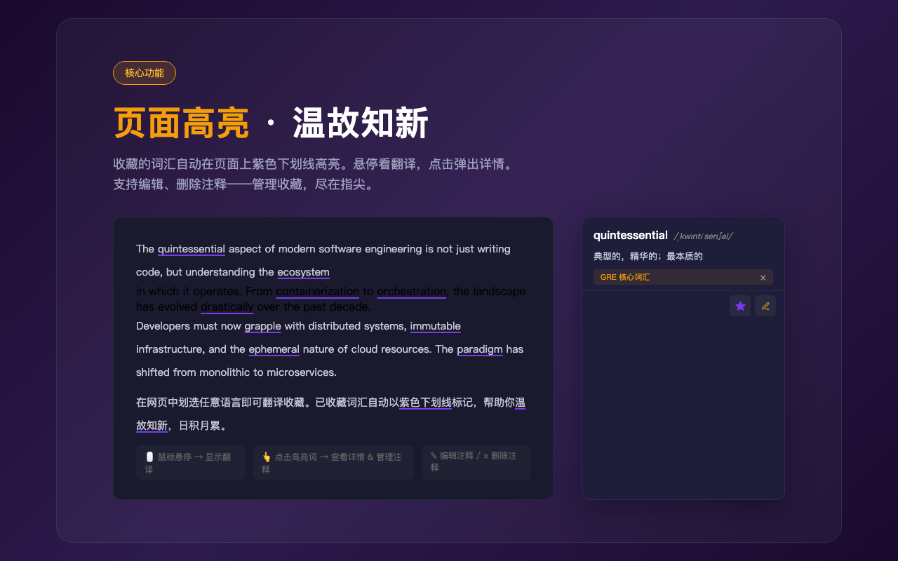
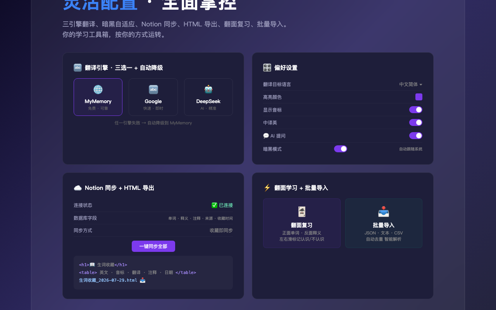

# 📖 拾词

> 划词即入口 — 选中一段文字，翻译、追问 AI、收藏、跳回原文，阅读里的每一段都顺手拾起

一个轻量级 Chrome 扩展：在任意网页选中文本，就地完成「翻译 · 问 AI · 收藏」，并在日后自动高亮、闪卡复习、一键回看原文。

## 💡 一句话定位

**划词，然后干嘛都行。** 翻译只是划词的第一个出口，不是全部。

## ✨ 核心功能

### 🔤 划词翻译 · 第一个出口
- 任意网页选中英文单词/短语，即时弹出翻译
- 自动获取 IPA 音标（免费词典 API，无需密钥）
- 中译英：选中中文自动翻成英文
- Google 翻译 + DeepSeek 双引擎可选

### 💬 就地追问 AI · 省掉拷贝那一步
- 选中任何看不懂的内容，直接在弹窗里追问 AI，不用复制粘贴到大模型
- 自动携带选中原文作为上下文，多轮对话深挖用法
- 基于 DeepSeek，支持自定义 Prompt

### 📌 收藏 · 一键回原文
- 一键收藏，自动记录来源网址与上下文
- 词条列表里点词名 / 域名，直接跳回当初收藏的那个页面
- 支持 30 字个性化备注，本地存储、离线可用

### 🌈 高亮复习
- 已收藏词汇在任意网页自动高亮
- 自定义高亮颜色，悬停看释义，点击看详情或取消收藏

### 🃏 闪卡学习
- 收藏词汇一键生成闪卡，翻面自测
- 「认识 / 不认识」统计，支持方向键快速翻卡

### ☁️ Notion 同步
- 收藏词汇一键同步到 Notion 数据库
- 自动去重、笔记更新，支持全量补同步

### ⚙️ 灵活配置 & 导入导出
- **多目标语言**：简体中文、繁體中文、日本語、한국어、Español
- **开关控制**：划词功能、中译英、音标显示、AI 提问
- **批量导入**词条，**HTML / CSV** 格式导出收藏

## 📸 截图

<p align="center">
  
  
</p>
<p align="center">
  
  
</p>

## 📦 安装

1. 下载或克隆此仓库
2. 打开 Chrome，进入 `chrome://extensions/`
3. 开启「开发者模式」
4. 点击「加载已解压的扩展程序」
5. 选择本仓库根目录

## 🛠 技术栈

- **Chrome Extension Manifest V3**
- 原生 JavaScript（无框架依赖）
- Service Worker 后台
- Content Script 页面注入
- Chrome Storage API 本地持久化

## 📁 项目结构

```
HuaciFanyi/
├── manifest.json           # 扩展配置
├── background/
│   └── service-worker.js   # 后台服务（翻译、AI 提问、Notion 同步、词库管理）
├── content/
│   ├── index.js            # 页面注入脚本（划词、弹窗、AI 提问、高亮）
│   └── index.css           # 弹窗样式
├── popup/
│   ├── index.html          # 弹出面板（词汇列表、设置）
│   ├── index.js            # 面板逻辑
│   └── index.css           # 面板样式
├── options/
│   ├── index.html          # Notion 配置页
│   ├── index.js            # 配置逻辑
│   └── index.css           # 配置页样式
├── words/
│   ├── index.html          # 全部词汇浏览页（含闪卡、导入）
│   ├── index.js            # 词汇管理逻辑
│   └── index.css           # 词汇页样式
├── icons/                  # 扩展图标
└── promo/                  # 宣传页素材
```

## 🔑 API 配置

| 功能 | 是否需要密钥 | 说明 |
|------|:---:|------|
| Google 翻译 | ❌ | 内置免费使用 |
| DeepSeek 翻译 | ✅ | 需 [DeepSeek API Key](https://platform.deepseek.com/) |
| AI 提问 | ✅ | 与 DeepSeek 共用 Key |
| 音标查询 | ❌ | 免费词典 API |
| Notion 同步 | ✅ | 需 [Notion Integration](https://www.notion.so/my-integrations) |

## 📄 License

MIT
